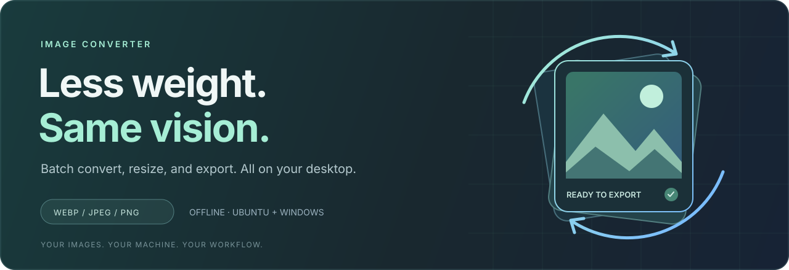
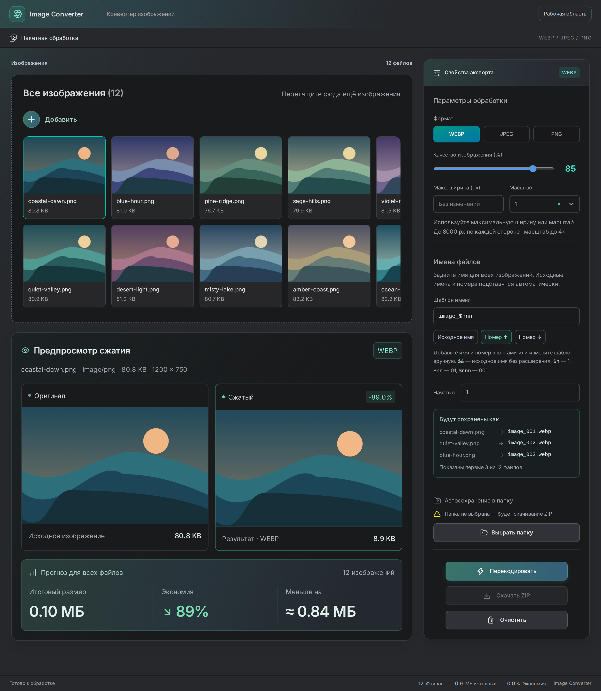

<p align="center">
  
</p>

<p align="center">
  <strong>A quieter workflow for lighter images.</strong><br>
  An offline desktop image converter for Ubuntu, Windows, and macOS.
</p>

<p align="center">
  <a href="https://github.com/evscoder/image-converter/releases/latest"></a>
  <a href="https://github.com/evscoder/image-converter/actions/workflows/build.yml"></a>
</p>



<p align="center">
  <a href="#get-the-app">Get the app</a> ·
  <a href="#built-for-the-whole-batch">Features</a> ·
  <a href="#three-steps-to-ready">How it works</a> ·
  <a href="#run-from-source">Build from source</a> ·
  <a href="https://github.com/evscoder/image-converter/issues">Feedback</a>
</p>

## Your next export, already organized.

Drop in your images. Choose a format, tune the quality, and check the preview.
Export the whole batch to a folder or download it as a ZIP.
Image processing happens locally on your machine.



*The current interface uses Russian labels. The preview above uses demonstration artwork.*

## Built for the whole batch

| See what you are changing | Set it once. Export together. |
| :--- | :--- |
| **Preview before export.** Compare the original with the encoded image and inspect the estimated output size. | **Three output formats.** Export WebP, JPEG, or PNG. Adjust quality for WebP and JPEG. |
| **Keep the layout comfortable.** Content and settings scroll independently in wide windows; narrow windows use one scrolling workspace. | **Resize as you convert.** Set a maximum width while keeping the image proportions. |
| **Follow every file.** Browse thumbnails and see processing and completion states. | **Preview export names.** Combine a filename template, original names, and ascending or descending numbers. Check the live examples before exporting. |

Use the buttons in **Имена файлов** to insert the original name or a counter.
For example, `image_$nnn` produces `image_001.webp`, `image_002.webp`, and so on.
`$&` keeps the original filename without its extension. Use `$n` for `1`, `$nn`
for `01`, or `$nnn` for `001`, and choose the starting value. Descending numbers
end at the selected value. The preview shows the exact export names, including
suffixes added to keep duplicate names unique.

## Three steps to ready

1. **Add your images.** Drag files into the workspace or use the file picker.
2. **Shape the output.** Pick the format, quality, maximum width, and filename pattern.
3. **Export the batch.** Choose an output folder and convert, or download the processed images as a ZIP.

## Get the app

**[Open the latest release →](https://github.com/evscoder/image-converter/releases/latest)**

Choose the installer for your system from the release assets:

| Platform | File | Install |
| :--- | :--- | :--- |
| **Ubuntu / Debian** | `.deb` | Download, then run `sudo apt install ./your-downloaded-file.deb`. |
| **Linux** | `.AppImage` | Mark the file as executable, then launch it. |
| **Windows** | `.exe` | Run the installer and follow the setup steps. |
| **Windows** | `.msi` | Run the Windows Installer package. |
| **macOS (Apple Silicon / Intel)** | `.dmg` | Open the disk image and drag Image Converter to Applications. |

The macOS build is not signed with an Apple Developer ID or notarized. macOS
may block the first launch; see [Apple's instructions for opening an app from an unidentified developer](https://support.apple.com/guide/mac-help/open-a-mac-app-from-an-unknown-developer-mh40616/mac).

[All releases](https://github.com/evscoder/image-converter/releases) ·
[Build downloads](https://github.com/evscoder/image-converter/actions/workflows/build.yml) ·
[Report an issue](https://github.com/evscoder/image-converter/issues/new)

## Under the hood

**React + TypeScript** power the interface. **Tauri 2 + Rust** provide the desktop
shell, native file access, and native WebP/PNG processing. JPEG conversion uses
the webview's canvas encoder. **Vite** builds the frontend.

## Run from source

You need **Node.js 22**, **npm**, and a stable **Rust** toolchain. Install Rust
using the instructions at [rustup.rs](https://rustup.rs/).

### Ubuntu prerequisites

```bash
sudo apt update
sudo apt install -y \
  libwebkit2gtk-4.1-dev \
  build-essential \
  curl \
  wget \
  file \
  libxdo-dev \
  libssl-dev \
  libayatana-appindicator3-dev \
  librsvg2-dev
```

### Windows prerequisites

Install the C++ build tools and WebView2 described in the
[Tauri Windows setup guide](https://v2.tauri.app/start/prerequisites/#windows).
Build Windows installers on Windows and Linux installers on Linux.

### macOS prerequisites

Install Xcode Command Line Tools and both Rust targets for a universal installer:

```bash
xcode-select --install
rustup target add aarch64-apple-darwin x86_64-apple-darwin
```

Build macOS installers on macOS. The universal `.dmg` supports Apple Silicon
and Intel Macs.

### Start the desktop app

```bash
git clone https://github.com/evscoder/image-converter.git
cd image-converter
npm ci
npm --prefix app ci
npm run desktop:dev
```

### Build installers

```bash
# Ubuntu / Linux
npm run desktop:build:linux

# Windows
npm run desktop:build:windows

# macOS (Apple Silicon + Intel)
npm run desktop:build:macos
```

Installers are written to `src-tauri/target/release/bundle/`.
Universal macOS installers are written to
`src-tauri/target/universal-apple-darwin/release/bundle/dmg/`.

### Check the frontend

```bash
npm run build
npm test
npm --prefix app exec playwright install chromium
npm run test:e2e
```

Vitest runs unit and component tests with coverage in `app/coverage`.
Playwright starts Vite automatically and tests the browser workflow in Chromium,
including conversion, resizing, and ZIP contents. Native desktop APIs are covered
by component mocks; the browser tests do not launch Tauri.
Use `npm run test:watch` or `npm run test:e2e:ui` for interactive runs.

## Release workflow

The [desktop build workflow](.github/workflows/build.yml) builds Ubuntu, Windows,
and macOS installers when a version tag (`v*`) is pushed. A GitHub Release is
published after all three builds succeed. Pushes to `main` do not trigger this
workflow. Manual runs from a branch save downloadable Actions artifacts.

```bash
git tag -a v1.0.7 -m "Summarize the interface changes in this release"
git push origin v1.0.7
```

Use a new annotated `vMAJOR.MINOR.PATCH` tag for each release. Put a short
changelog in the tag message; it becomes the GitHub Release description.
The tag determines the exact installer version; it does not need to match
`tauri.conf.json`. The five installer formats are attached to the release.
The workflow uses the built-in `GITHUB_TOKEN`.

<details>
<summary><strong>Build numbering and reruns</strong></summary>

For manual runs from a branch, the workflow run number is added to the patch
version in `src-tauri/tauri.conf.json`. A base version of `1.0.4` and run number
12 produce `1.0.16`. All platforms use the same version. Failed runs also
consume run numbers; rerunning the same run keeps its version.

Version changes stay in the CI working copy. No automatic version commits are
created. Local builds use the version in `tauri.conf.json`.

Rerunning a tagged workflow replaces the installer files on the existing release.

</details>

---

<p align="center">
  <strong>Make room for what matters.</strong><br>
  <a href="https://github.com/evscoder/image-converter/releases/latest">Download Image Converter</a> ·
  <a href="https://github.com/evscoder/image-converter/issues">Help improve it</a>
</p>
